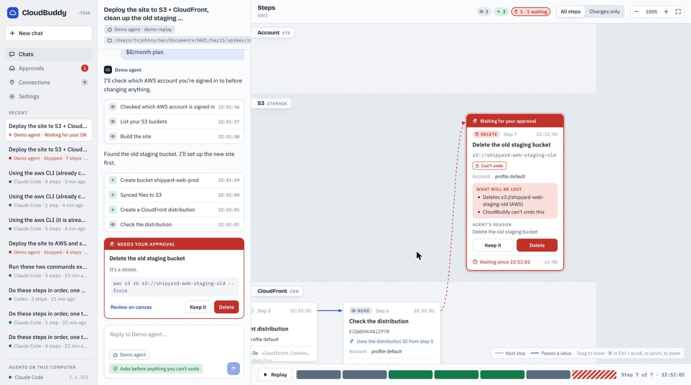

# CloudBuddy

**See what your AI agent does to your cloud, and stop it before anything you can't undo.**

CloudBuddy is a local web app that runs Claude Code, already on your computer, for cloud work: deploying, monitoring, checking production data, setting up Stripe, adding DNS records in Cloudflare. It works like Claude Code in your own terminal, with your project's setup and your CLI logins. Every step the agent takes becomes a card on a timeline, and CloudBuddy **stops the agent before anything that can't be undone**:
- deletes
- moving money
- sending to real people
- live mode

You approve or deny right on the canvas.



- **Chat** with the agent, like the Claude desktop app. Its replies are formatted (lists, tables, code blocks you can copy).
- **Projects**: a name and the folders that belong together, such as an app and its infrastructure code. Start a chat in a project and the agent has all of them.
- **Canvas** beside the chat, which you can fold away to give the chat the room: one card per cloud step, left to right in order, one lane per provider. Back-to-back reads stack into one card. A line runs from something a step created to each later step that builds on it; a value found earlier is a chip you can hover to trace.
- **Approvals** before deletes, payments, sends and live-mode changes, with what will be lost and the agent's reason.
- **Dashboards**: ask in a chat for numbers you want to keep an eye on (user counts, signups, revenue, errors) and the agent saves a dashboard. CloudBuddy then reruns its commands itself on a timer, with no agent and no tokens, and draws numbers with trends, line charts, bars, tables and status tiles. Commands it can't tell only read wait for your OK once; deletes, payments and sends can never run from a dashboard.
- **History**: every chat keeps its canvas. Reopen it, replay it step by step.
- **Connections**: which CLIs and MCP servers the agent can reach, who they are signed in as, and a rule per connection (Off, Read-only, Ask before every change…).

It runs only on your computer (`127.0.0.1`), uses your existing agent logins and cloud CLIs, and never stores your keys.

## Status

`v0.1.0` is the first release. It works on **macOS** with **Claude Code**; Codex support is coming soon. Linux runs without CloudBuddy's file rules for commands until the Linux sandbox is built (see [Safety](docs/security.md)). Windows isn't supported yet.

## Quick start

You need: Go 1.24+, Node 20+, Docker, and Claude Code installed and signed in.

```bash
git clone <this repo> cloudbuddy && cd cloudbuddy
make db-up          # PostgreSQL in Docker on 127.0.0.1:54329
make release        # builds the frontend and a single binary: bin/cloudbuddy
bin/cloudbuddy      # opens your browser
```

CloudBuddy opens `http://127.0.0.1:7420` in your browser, the landing page. **Open CloudBuddy** takes you to the app at `/app`. There is no sign-in: it runs on your own computer, and you can open the address again any time while it's running.

Pick your agent in **Settings**, add a project (its name and folders, picked with **Choose…**) with **+** next to Projects, then click **New chat** and describe the job. The first message starts the chat.

### Try it without an agent

```bash
bin/cloudbuddy --fake testdata/scenarios/demo.json
```

This adds a **Demo agent** that replays a deploy run, so you can try approvals without touching any cloud account.

## How it works

```
 browser ── CloudBuddy (Go, 127.0.0.1:7420) ── claude CLI ── your cloud CLIs and MCP servers
                     │
               gate: recognizer → policy → ask you → release once
```

1. CloudBuddy starts Claude Code the way your terminal would in that folder: your login-shell environment, the folder's direnv setup, your MCP servers. It adds a hook on every tool call and loads no user or project settings that could switch the hook off.
2. Before any tool call runs, the **recognizer** works out what it does:
   - provider, action and identity;
   - warning tags: Can't undo, Moves money, Reaches people, Live.
3. The **policy** decides. Everything runs as in your terminal unless it can't be undone (deletes, payments, messages to people, live-mode changes) or your Connections rules say otherwise. Then it asks you.
4. Commands run through `cloudbuddy exec` with network, under a sandbox profile that only keeps CloudBuddy's own files, your agent settings and CloudBuddy's port off-limits.
5. Inside scripts, shims for your cloud CLIs show each call as its own card and ask before deletes there too. A small network log adds where each command went ("Talked to api.supabase.com"), so a script lands in its provider's lane.
6. Background commands such as log tails run too; the card stays live and has a **Stop** button.

Every decision fails closed: if CloudBuddy can't decide, can't reach you, or crashes, the action doesn't run.

## Adapters

CloudBuddy knows AWS (every service, generated from the AWS CLI models), Stripe, Cloudflare and Resend. Anything else that has a CLI or an MCP server still works: CloudBuddy guesses from the command and asks only when it looks like a delete, a payment or a message to people.

Adapters are YAML files. See [docs/adapters.md](docs/adapters.md) to add one.

## Safety and its limits

Read [docs/security.md](docs/security.md) before trusting CloudBuddy with production accounts. In short, commands run like they do in your terminal, so what CloudBuddy can't see, it can't stop: a script that calls a cloud API through an SDK shows as one card, not each operation. It also can't stop cloud changes made outside the agent. Secret masking covers known formats only.

## Development

```bash
make db-up
make build && bin/cloudbuddy serve --dev --no-open   # API on :7420
cd web && npm run dev                                 # UI on :5173 (or npm run dev:mock without a server)
make test                                             # Go and frontend tests
```

- `docs/api.md`: the HTTP API between server and browser.
- `spikes/`: the Phase 0 experiments that proved the agent integration.

## License

Apache-2.0. See [LICENSE](LICENSE).
